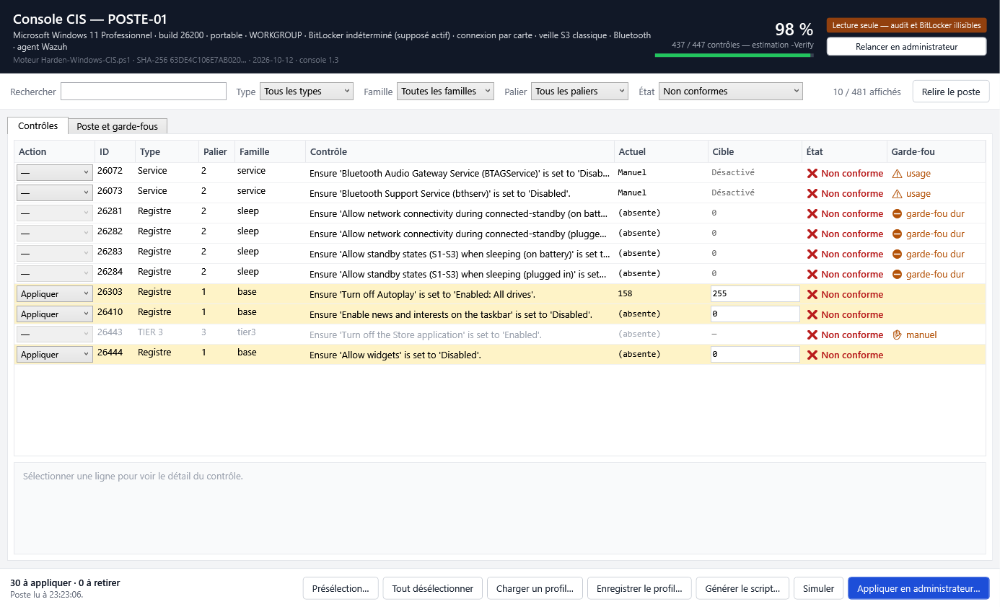

# Console CIS — durcissement Windows 11 sur mesure

[](https://github.com/Dylann-fgt/console-cis/actions/workflows/ci.yml)

Durcit un poste Windows 11 selon le **CIS Microsoft Windows 11 Enterprise Benchmark v3.0.0**,
tel que l'évalue le module SCA de Wazuh — **sans casser ce dont le poste se sert**.
PowerShell 5.1, aucune dépendance, rien à installer.



## Pourquoi

Appliqué en bloc, un durcissement CIS casse des usages, et souvent sans le dire : la caméra
disparaît pour toutes les applications, la veille n'est plus que la veille prolongée, une
ouverture de session par carte à puce ne passe plus. Chacun de ces cas est arrivé sur un vrai
poste ; le [CHANGELOG](CHANGELOG.md) dit lequel a apporté quel garde-fou.

Cet outil part donc de trois principes :

- **Lire le poste avant d'agir.** Imprimante, Bluetooth, webcam, WSL, RDP, partages, BitLocker,
  compte Microsoft, carte à puce, états de veille… Un contrôle qui casserait un usage constaté
  est écarté, **avec sa raison**.
- **Ne rien deviner.** Chemin, nom et valeur de chaque réglage sont extraits du fichier de
  règles que Wazuh utilise lui-même pour vérifier (`cis_win11_enterprise.yml`).
- **Pouvoir revenir en arrière.** Rien n'est écrit sans sauvegarde préalable et sans
  `Rollback.cmd`.

## Contenu

| Fichier | Rôle |
|---|---|
| `console/Console-CIS.cmd` | **La console graphique** — double-clic |
| `console/Console-CIS.ps1` | Voir chaque contrôle, choisir ligne par ligne, générer un script sur mesure |
| `Harden-Windows-CIS.ps1` | **Le moteur** en ligne de commande : mesure, simulation, application par paliers |
| `console/LISEZ-MOI.md` · `LISEZ-MOI-PORTABLE.md` | Mode d'emploi de la console, et de sa version portable (clé USB, plusieurs postes) |
| `tools/` | Génération des tables depuis les règles Wazuh, et assemblage du moteur |

## Démarrer

1. Télécharger la dernière [release](https://github.com/Dylann-fgt/console-cis/releases)
   (ou **Code → Download ZIP**).
2. **Débloquer le zip avant de l'extraire.** Windows marque tout ce qui vient d'Internet, et
   PowerShell refuse ensuite de lancer le moteur. Clic droit sur le `.zip` → **Propriétés** →
   cocher **Débloquer** ; ou, en PowerShell :

   ```powershell
   Unblock-File .\Console-CIS-1.3.zip     # puis extraire
   ```

3. **Double-clic sur `console/Console-CIS.cmd`.** La console s'ouvre **en lecture seule** : rien
   n'est écrit sur le poste sans une confirmation explicite. Le bouton « Relancer en
   administrateur » rend tout lisible (politique d'audit, BitLocker).
4. Choisir, **Simuler**, puis **Appliquer en administrateur**. Redémarrer ensuite : plusieurs
   réglages ne prennent effet qu'au démarrage.

> **Avant le premier passage** sur un poste qui compte : l'essayer sur une machine virtuelle,
> garder un accès de secours (mot de passe du compte, ou second compte administrateur), et lire
> la simulation en entier.

## Le moteur en ligne de commande

```powershell
.\Harden-Windows-CIS.ps1 -Verify                     # score estimé, rien n'est modifié
.\Harden-Windows-CIS.ps1 -IncludeOptional            # simulation TIER 1 + 2
.\Harden-Windows-CIS.ps1 -Apply                      # TIER 1, PowerShell en administrateur
.\Harden-Windows-CIS.ps1 -Apply -IncludeOptional     # TIER 1 + 2
Get-Help .\Harden-Windows-CIS.ps1 -Full              # toutes les options
```

| Palier | Contenu | Déclencheur |
|---|---|---|
| **TIER 1** | réglages sans effet visible à l'usage, politique de mots de passe et de verrouillage, 27 sous-catégories d'audit, compte invité, SMBv1 | `-Apply` |
| **TIER 2** | services, ASR, Microsoft Store, winget, veille, RDP, restrictions de périphériques, compte Microsoft, bannière d'ouverture de session | `-Apply -IncludeOptional` |
| **TIER 3** | protection LSA, VBS / Credential Guard, LAPS, renommage des comptes, BitLocker à fort impact, suppression du Store | jamais automatique : affiché avec sa raison |
| **Score seul** | contrôles qui font gagner du score en dégradant la sécurité réelle | `-ScoreOnly` |

## Garde-fous

| Verrou | Ce qu'il protège | Levé par `-IgnoreGuards` ? |
|---|---|---|
| **D'usage** | imprimante, Bluetooth, webcam, WSL, SSH, RDP, partages, géolocalisation, Xbox, notifications, BitLocker, LAPS, compte Microsoft, code PIN | oui |
| **Carte à puce** | sur un poste qui ouvre sa session par carte à puce via un package d'authentification tiers (EIDAuthenticate), la protection LSA et le bloc VBS / Credential Guard passent en **liste noire** : LSASS protégé ou isolé ne charge plus ce package, et le verrou UEFI ne se retire pas sans accès physique | **non** |
| **Veille** | sur un poste sans Modern Standby, `26281`-`26284` supprimeraient le dernier état de veille ; une reprise ratée depuis la veille prolongée jette les écritures en cache | **non** |

La liste noire est revérifiée à chaque exécution, et par chaque script généré : si une table
la viole, rien n'est écrit (code 2). Un script généré par la console ne tourne que sur le poste
pour lequel il a été fait (code 3, sauf `-AnyHost`).

## Choix assumés

Quand la règle Wazuh tolère plusieurs valeurs, le moteur retient **la moins destructrice** et
laisse un commutateur pour durcir davantage : un durcissement qui casse un usage finit annulé.

| Contrôle | Retenu | Écarté, et pourquoi |
|---|---|---|
| `26061` NTLM sortant | `1` auditer | `2` refuser coupe l'accès aux partages SMB et aux NAS → `-StrictNTLM` |
| `26192` NetBIOS | `2` réseaux publics | `0` partout casse la découverte de NAS et d'imprimantes → `-StrictNetBIOS` |
| `26191` DNS sur HTTPS | `2` autoriser | `3` exiger coupe la résolution si le résolveur ne gère pas DoH |
| `26214` RPC d'impression | `0` négocier | `1` Kerberos seul casse l'impression hors domaine |
| `26030` retrait de la carte | `1` verrouiller | `2` / `3` ferment ou déconnectent la session |
| `26389` Microsoft MAPS | non appliqué | le gagner suppose de couper la protection cloud de Defender → `-ScoreOnly` seulement |

À savoir : sur un poste **sans** BitLocker actif, le TIER 1 pose `26332`/`26333`. Activer
ensuite BitLocker sur le volume système exigera alors **TPM + PIN**, jamais le TPM seul.

## Sauvegarde et retour arrière

Avant toute écriture : point de restauration, export `.reg` de chaque clé touchée, état des
services, et un **`Rollback.cmd`** qui réimporte les clés, **supprime** les valeurs créées et
remet chaque service à son type de démarrage d'origine (un simple `reg import` ne retire pas ce
qui n'existait pas).

| Lancé depuis | Sauvegarde, journal et `Rollback.cmd` |
|---|---|
| le moteur | `%LOCALAPPDATA%\CIS-Hardening-Backup\<date>\` |
| la console | `C:\ProgramData\CIS-Console-Backup\<date>\` — avec `auditpol /backup` et `net accounts` |

## Ce qui a été éprouvé — et ce qui ne l'a pas été

- **Application réelle** en administrateur sur **un** poste Windows 11 (build 26200, en
  français, session par carte à puce) : cinq applications puis un retrait, score passé de 326 à
  440 sur 447 contrôles.
- **Vérifié sans élévation** : inventaire complet, score identique entre la console et le
  moteur, génération, simulation, refus de la liste noire et d'un autre poste.
- **Pas encore éprouvé** : un Windows en anglais, un poste sans carte à puce, un poste membre
  d'un domaine, le mode portable depuis une clé USB ou un lecteur réseau mappé.

Les retours sur d'autres configurations sont bienvenus — voir plus bas.

## Modifier le moteur

`Harden-Windows-CIS.ps1` est **assemblé** : on modifie `tools/engine-head.ps1` (aide,
paramètres, liste noire) ou `tools/engine-tail.ps1` (profil, garde-fous, application, rapports),
**jamais le script assemblé**, puis :

```powershell
.\tools\assemble.ps1
```

Les tables sont reprises du script en place. La CI vérifie à chaque envoi que réassembler
redonne exactement le fichier publié.

Pour **régénérer les tables** depuis les règles Wazuh, il faut Python 3 et un agent Wazuh
installé (pour son fichier de règles) :

```powershell
cd tools
python parse_sca.py ; python derive.py ; python gen_tables.py
.\assemble.ps1          # ou : python assemble.py — les deux produisent le même fichier
```

## Signaler un problème

Bogue, contrôle mal classé, garde-fou manquant : une [issue](https://github.com/Dylann-fgt/console-cis/issues),
avec la version de Windows et la sortie de `-Verify`. Pour une **faille de sécurité**, ne pas
publier de détails exploitables dans une issue publique : passer par l'onglet **Security** du
dépôt.

## Licence et avertissement

[GPL-2.0](LICENSE). Chacun peut utiliser, étudier, modifier et redistribuer ce code ; une
version modifiée redistribuée reste sous la même licence, avec ses sources. Les tables sont
dérivées de `cis_win11_enterprise.yml`, fichier de règles SCA de Wazuh publié sous GPL v2, lui-même
fondé sur le CIS Microsoft Windows 11 Enterprise Benchmark v3.0.0.

Ce projet n'est **ni affilié, ni approuvé** par le Center for Internet Security ni par Wazuh.
« CIS » et « CIS Benchmarks » sont des marques du Center for Internet Security ; un score
obtenu ici ne vaut pas certification.

L'outil modifie la configuration de sécurité de Windows. Il est fourni **tel quel, sans aucune
garantie** (articles 11 et 12 de la licence) : simuler d'abord, garder le `Rollback.cmd`, et
l'éprouver sur une machine de test avant un poste qui compte.
